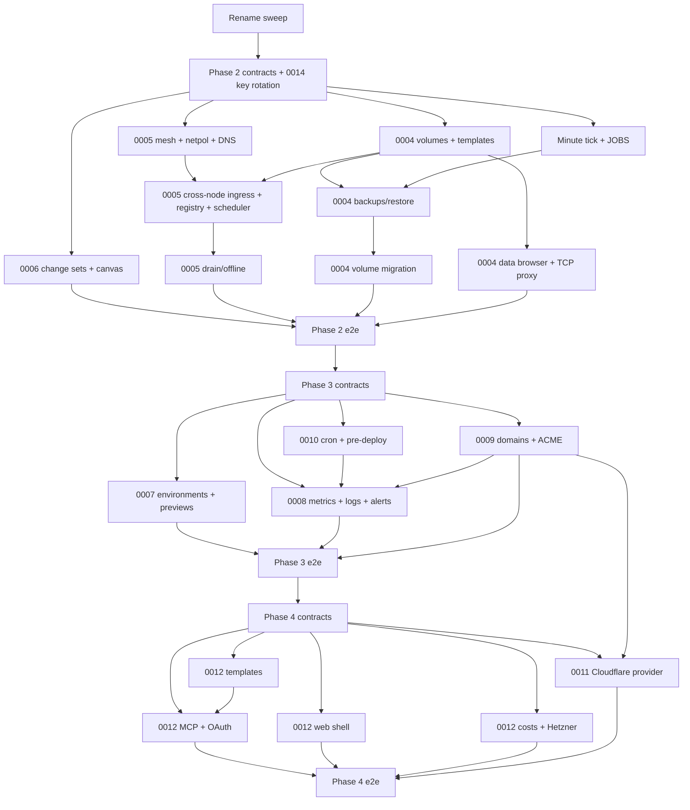

# 0013: Build and rollout order for Phases 2–4

## Status

Proposed.
- Date: 2026-10-22
- Covers: 0004–0012

## Context

ADRs 0004–0012 are built by several engineers at once, in a shared tree.
Two things make parallel work fail. The first is contracts that change
under people: protocol frames, D1 schema, route shapes. The second is
several people editing the same hot files, such as
`apps/api/src/durable/node-connection.ts` (910 lines),
`apps/api/src/lib/desired-state.ts`, `agent/internal/runtime/runtime.go`
(1,238 lines), `packages/shared/src/scheduler.ts`,
`apps/api/src/contracts.ts` and `packages/db/src/schema/*`.

Two constraints apply throughout. The control plane must keep accepting
agents one protocol version behind. Every phase must be provable on the
real stack, with Docker Desktop locally and GitHub Actions in CI, and
without third-party accounts.

## Decision

### Cross-cutting conventions

**Naming.** The rename sweep (Roundhouse → Roundhouse) lands **before**
Phase 2's contracts PR. New identifiers in 0004–0012 exist only in their
renamed form:
- labels `roundhouse.*`
- built-ins `ROUNDHOUSE_*`
- datasets and queues `roundhouse-*` / `roundhouse_*`
- Worker scripts `rh-*`

The sweep defines the mapping for existing identifiers. Live containers
carry `roundhouse.*` labels, so the agent reads both prefixes for one
protocol version, the same way it adopts unlabelled Phase 1 containers.

**Protocol versions.** One version per phase, and each phase's control
plane accepts exactly N−1.

| Phase | `PROTOCOL_VERSION` | `MIN_PROTOCOL_VERSION` | Gates (constant = version)                                                                                                                                                                                   |
| ----- | ------------------ | ---------------------- | ------------------------------------------------------------------------------------------------------------------------------------------------------------------------------------------------------------ |
| 2     | 4                  | 3                      | `MESH_`, `VOLUMES_`, `BACKUPS_`, `DB_QUERY_PROTOCOL_VERSION` = 4 (mesh, route workloads, mounts, `exec` probes, `stop_first`, publish, backup/restore/copy frames, `db_query`, `task` logs, `volume_status`) |
| 3     | 5                  | 4                      | `JOBS_`, `METRICS_`, `CERTS_PROTOCOL_VERSION` = 5 (`job_*`, `metrics`, `cert_*`, wildcard routes, `hsts`, `ingress` block, `managed` TLS)                                                                    |
| 4     | 6                  | 5                      | `EXEC_`, `IMAGE_PUSH_`, `EDGE_GATEWAY_PROTOCOL_VERSION` = 6 (`exec_*`, `image_push`, `edge_gateway`)                                                                                                         |

Raising `MIN_PROTOCOL_VERSION` from 1 to 3 at Phase 2 drops pre-release
Phase 0 and Phase 1 agents. `hello` from an agent below the minimum is
answered with close code 4002 (`agent_outdated`, new), and the node shows
"upgrade agent" with the `install.sh --upgrade` command. Every new field
or frame is sent only at or above its gate, and the scheduler's
`agent_outdated` filter keeps version-gated placements off older agents
(0005).

**Control-plane signing key rotation.** ADR 0002 left key rollover as a
TODO (`agent/internal/conn/conn.go`). Phases 2–4 add many
credential-carrying frames, so rollover lands in Phase 2:
- `welcome.next_keys: { kid, public_key, not_before }[]`, signed by the
  current key, lets the agent pin successors.
- `POST /v1/instance/signing-keys/rotate` (`instance:manage`) generates a
  new key, announces it, and switches 24 h later.

The details follow ADR 0002's constraint that envelope changes need an
ADR, so a short ADR 0014 accompanies the Phase 2 contracts PR.

**RBAC.** New actions, all added to `ACTIONS`, `ROLE_GRANTS` and the token
scopes:

| Action                | owner | admin | member | viewer | ADR                             |
| --------------------- | ----- | ----- | ------ | ------ | ------------------------------- |
| `changes:approve`     | ✓     | ✓     |        |        | 0006                            |
| `changes:auto_apply`  | ✓     | ✓     | ✓      |        | 0006 (token scope that matters) |
| `data:read`           | ✓     | ✓     | ✓      |        | 0004                            |
| `data:write`          | ✓     | ✓     |        |        | 0004                            |
| `backups:manage`      | ✓     | ✓     | ✓      |        | 0004                            |
| `backups:restore`     | ✓     | ✓     |        |        | 0004                            |
| `environments:manage` | ✓     | ✓     | ✓      |        | 0007                            |
| `previews:manage`     | ✓     | ✓     |        |        | 0007                            |
| `alerts:read`         | ✓     | ✓     | ✓      | ✓      | 0008                            |
| `alerts:manage`       | ✓     | ✓     | ✓      |        | 0008                            |
| `channels:manage`     | ✓     | ✓     |        |        | 0008                            |
| `domains:manage`      | ✓     | ✓     | ✓      |        | 0009                            |
| `shell:open`          | ✓     | ✓     |        |        | 0012                            |
| `templates:publish`   | ✓     | ✓     |        |        | 0012                            |
| `providers:manage`    | ✓     | ✓     |        |        | 0012                            |

`API_TOKEN_PRESETS.deploy` stays as it is. It does not gain
`changes:auto_apply`; that scope must be chosen explicitly.

**ID prefixes.** New `ID_PREFIXES`, all 1–8 lowercase letters per
`ID_RE`:

| ADR  | Prefixes                                  |
| ---- | ----------------------------------------- |
| 0004 | `vol`, `bak`, `bpl`, `rst`, `mig`, `tcp`  |
| 0006 | `chs`, `stg`, `edg`                       |
| 0007 | `prv`                                     |
| 0008 | `alr`, `inc`, `nch`, `inb`, `lsq`         |
| 0009 | `cer`                                     |
| 0010 | `crn`                                     |
| 0011 | `cfd`                                     |
| 0012 | `oac`, `oag`, `tpl`, `shl`, `pcr`, `prov` |

**Scheduled work.** One mechanism serves every phase: the minute tick
plus the `JOBS` queue plus a Workflow per unit of work (0004, "Scheduled
dispatch"). It is built in Phase 2, and 0007, 0008 and 0010 only register
claimers.

**Fakes.** All live in `e2e/lib/` and are shared with unit tests. Each is
backed by fixtures recorded from official docs or live accounts:
- `fake-s3.mjs`, which enforces R2's rules;
- `fake-github.mjs`;
- `fake-cloudflare.mjs` (DNS, custom hostnames, Workers scripts and
  routes, Containers, registry credentials);
- the existing `packages/providers/test/fakes/hetzner.ts`;
- Pebble with `pebble-challtestsrv` for ACME, and a DoH shim over it.

A fake never invents behaviour the docs do not state. Undocumented
behaviour is listed in its ADR's open questions and checked by the live
verification scripts.

### Contracts first, then disjoint ownership

Each phase starts with **one contracts PR**, owned by the phase lead. It
must be merged before any workstream starts, and it contains:
1. **Protocol:** zod schemas in `packages/protocol/src`, the Go types in
   `packages/protocol/go`, JSON Schemas, signed fixtures verified by both
   sides, the version gates, and `carriesCredentials` updates.
2. **D1 schema** for the whole phase, in `packages/db/src/schema/*`, as
   **one** generated migration (`0004_phase2.sql`, `0005_phase3.sql`,
   `0006_phase4.sql`). Workstreams never edit the schema. A missing column
   is a follow-up contracts PR.
3. **Shared vocabulary:** new modules in `packages/shared/src` with types
   and constants, and stub functions that throw `not implemented`. Also
   `ACTIONS`, `ROLE_GRANTS`, `AUDIT_ACTIONS`, `ID_PREFIXES`,
   `DEPLOYMENT_TRIGGERS` and `DEPLOYMENT_EVENT_TYPES`.
4. **Routes:** every route as a `defineRoute` in `apps/api/src/contracts.ts`
   (or a new `contracts/<area>.ts` re-exported from it), with its policy
   and response schemas, but no handlers.
5. **Hot-file splits.** The hot files are split into owned modules, with
   no behaviour change:
   - `durable/node-connection.ts` becomes a frame dispatch table plus
     `durable/node/handlers/<frame-group>.ts`;
   - `lib/desired-state.ts` becomes `lib/desired-state/{index,workloads,mesh,volumes,registry,ingress}.ts`;
   - `agent/internal/runtime/runtime.go` exposes `MountProvider`,
     `NetworkHooks` and `ProbeRunner` interfaces, implemented in new
     packages;
   - `agent/internal/conn` dispatches new frame types to a `Handler`
     interface with one method per frame group.
6. **Bindings:** `wrangler.jsonc` and `env.ts` gain every new binding for
   the phase, with placeholders where a resource is created on first
   deploy.

### Dependency graph

Edges are hard dependencies. Anything without an edge between them runs
in parallel.

### Phase 2 (protocol 4): data, mesh, canvas

| Stream | Scope                                                                                                                                                                             | Owns (exclusive)                                                                                                                                                                                                                                                     |
| ------ | --------------------------------------------------------------------------------------------------------------------------------------------------------------------------------- | -------------------------------------------------------------------------------------------------------------------------------------------------------------------------------------------------------------------------------------------------------------------- |
| 2A     | Agent mesh: `wg0`, keys, rotation, nftables, private DNS, gateway-ready policy hooks                                                                                              | `agent/internal/mesh/**`, `agent/internal/netpol/**`, `agent/internal/ingress/dns.go` (private zone)                                                                                                                                                                 |
| 2B     | Agent data plane: volumes and quotas, mount exclusivity, `stop_first`, `exec` probes, backup/restore/copy pipeline, RHBK1, `db_query` drivers, TCP publish                        | `agent/internal/volumes/**`, `agent/internal/backup/**`, `agent/internal/dbquery/**`, `agent/internal/runtime/**` (implements the hooks)                                                                                                                             |
| 2C     | Control plane placement: scheduler fields and filters, mesh allocation (indexes, mesh IPs, `net_tag`, PSKs, pair paths), registry modes, drain and offline workflows              | `packages/shared/src/scheduler.ts`, `apps/api/src/lib/mesh/**`, `lib/desired-state/{mesh,registry,ingress}.ts`, `workflows/drain.ts`, `durable/node/handlers/mesh.ts`                                                                                                |
| 2D     | Control plane data services: database templates, credentials and rotation, volumes API, minute tick and `JOBS`, backup and migration workflows, query relay, TCP proxy allocation | `packages/shared/src/databases.ts`, `apps/api/src/lib/{dispatch,databases,backups,s3}/**`, `workflows/{backup,volume-migration}.ts`, `routes/{databases,volumes,backups,data}.ts`, `lib/desired-state/volumes.ts`, `durable/node/handlers/{backup,query,volumes}.ts` |
| 2E     | Change sets and canvas API, realtime presence                                                                                                                                     | `packages/shared/src/changes.ts`, `apps/api/src/lib/changes/**`, `routes/{change-sets,canvas}.ts`, `durable/project-room.ts`                                                                                                                                         |
| 2F     | Dashboard: canvas, staged bar, review panel, presence                                                                                                                             | `apps/web/src/features/{canvas,changes}/**`                                                                                                                                                                                                                          |
| 2G     | Dashboard: database add, Data, Backups, Volume tabs, Servers → Network, drain UI                                                                                                  | `apps/web/src/features/{data,backups,volumes,network}/**`                                                                                                                                                                                                            |
| 2H     | Real-stack harness: two-node dind stack, fake S3                                                                                                                                  | `e2e/phase2/**`, `e2e/lib/{fake-s3,stack2}.mjs`                                                                                                                                                                                                                      |
| 2I     | Installer: `--upgrade`, sysctl, `daemon.json` fwmark, ufw 51820/udp; Hetzner firewall rule                                                                                        | `install/**`, `packages/providers/src/firewall.ts`                                                                                                                                                                                                                   |
| 2J     | Signing key rotation (ADR 0014)                                                                                                                                                   | `agent/internal/conn/keys.go`, `apps/api/src/lib/signing-keys.ts`, `routes/signing-keys.ts`                                                                                                                                                                          |

**Order inside the phase.** 2H starts on day one against stubs. 2A+2C and
2B+2D pair up on fixtures early.

| Milestone | Proves                                                                          |
| --------- | ------------------------------------------------------------------------------- |
| M1        | Two dind nodes mesh up, and the isolation test passes on both firewall backends |
| M2        | Postgres template active on one node                                            |
| M3        | An app on node A reaches Postgres on node B through private DNS                 |
| M4        | Backup and restore round-trip through the fake S3                               |
| M5        | Drain, offline rescheduling, volume migration                                   |
| M6        | Canvas multiplayer against M3's project                                         |

**Phase 2 real-stack e2e** (`node e2e/phase2/run.mjs`, CI job
`e2e-phase2`, 60 min budget):
1. **Two nodes, mesh, isolation.** Two agents join, `GET /mesh` shows a
   direct path, and `mesh_ready` is true on both. Production and staging
   spread over both nodes cannot reach each other by IP or name.
2. **Next.js and Postgres across two nodes.** Add Postgres 18 pinned to
   node B through a change set. A Next.js app on node A has
   `DATABASE_URL=${{db.DATABASE_URL}}`, and the canvas shows the edge.
   The app writes a row through HTTP, served from node B's ingress through
   A's replica.
3. **Backup and restore round-trip.** A manual backup lands in the fake S3
   (encrypted, equal parts). Write row 2. Restore into a new service: it
   has 1 row. Restore in place: 1 row, and a `pre_restore` backup exists.
4. **Data browser.** Read-only `INSERT` is refused, write mode works, and
   both are audited.
5. **Drain and migrate.** Drain node A under a request loop with 0 failed
   requests. Migrate Postgres's volume from B to A, keeping its rows.
6. **Offline.** Stop node B's engine. After 150 s, stateless replicas move
   to A and Postgres is `degraded`. Restart B: its stale replicas are
   removed.
7. **Canvas multiplayer** (Playwright, two users): presence, a conflict
   and its resolution, a protected-environment approval.
8. **Mesh key rotation.** Rotate under a cross-node request loop: at most
   3 s of errors.
9. **Compat.** The suite's step 2 runs again with the **previous** agent
   release (protocol 3) as node B. It must receive no v4 fields, run
   stateless workloads, and be excluded from volume placement with
   `agent_outdated`.

### Phase 3 (protocol 5): environments, observability, domains, cron

| Stream | Scope                                                                                                                                        | Owns                                                                                                                                                                                                                                   |
| ------ | -------------------------------------------------------------------------------------------------------------------------------------------- | -------------------------------------------------------------------------------------------------------------------------------------------------------------------------------------------------------------------------------------- |
| 3A     | Cron: parser, claimer, run workflow, `pre_deploy`; agent job runner                                                                          | `packages/shared/src/cron.ts`, `workflows/cron-run.ts`, `routes/cron.ts`, `durable/node/handlers/jobs.ts`, `agent/internal/jobs/**`                                                                                                    |
| 3B     | Metrics: agent cgroup sampler, DO writes, `MetricsStore` (Analytics Engine and D1)                                                           | `agent/internal/metrics/**`, `apps/api/src/lib/metrics/**`, `durable/node/handlers/metrics.ts`, `routes/metrics.ts`, `packages/shared/src/metrics-layout.ts`                                                                           |
| 3C     | Logs explorer: level detection, chunk counts, query parser, search, saved searches, live topic                                               | `packages/shared/src/log-query.ts`, `apps/api/src/lib/logs/**` (the existing `lib/logs.ts` moves here), `routes/log-search.ts`, `durable/node/handlers/logs.ts`                                                                        |
| 3D     | Alerts: signals, evaluator, state machine, channels, delivery, inbox                                                                         | `apps/api/src/lib/alerts/**`, `routes/{alerts,channels,inbox}.ts`                                                                                                                                                                      |
| 3E     | Environments and previews: clone, diff, promote, webhook `pull_request`, preview workflow, GitHub feedback, fake GitHub                      | `apps/api/src/lib/{environments,previews}/**`, `workflows/preview.ts`, `routes/{environments,previews}.ts`, `lib/github.ts` (preview additions), `e2e/lib/fake-github.mjs`                                                             |
| 3F     | Domains and TLS: checker, ACME client, certificate workflow, SaaS client, `cert_sync`; agent cert store, Caddy config changes, `cert_status` | `apps/api/src/lib/{domains,acme,cloudflare}/**`, `workflows/cert.ts`, `routes/domains.ts`, `durable/node/handlers/certs.ts`, `agent/internal/ingress/{certs,config}.go`, `e2e/lib/fake-cloudflare.mjs` (DNS and custom-hostname parts) |
| 3G     | Dashboard: environments, previews, metrics charts, logs explorer, alerts, inbox, domains, cron tabs                                          | `apps/web/src/features/{environments,previews,metrics,logs,alerts,inbox,domains,cron}/**` — two engineers, split by folder                                                                                                             |
| 3H     | Real-stack harness: Pebble, challtestsrv, DoH shim, webhook receiver, scheduled-handler driver                                               | `e2e/phase3/**`                                                                                                                                                                                                                        |

3D consumes 3A's and 3F's events through `signalAlert` (defined in the
contracts PR), so the three streams run in parallel.

**Phase 3 real-stack e2e** (`e2e-phase3`, 75 min):
1. **Preview lifecycle** with the fake GitHub, for Next.js + Postgres:
   opened → environment `pr-1` with its own database and one comment;
   synchronize → redeploy and the comment is updated; a fork PR stays
   gated until a `write` user labels it, and its secrets come out empty;
   closed → environment removed.
2. **Clone and promote.** Clone production with `latest_backup`; promote
   staging → production with `image: true`, with no rebuild and the same
   digest.
3. **Cron.** `*/1` runs succeed with logs. A timeout gives `timed_out`;
   `forbid` gives `skipped`; a control-plane outage gives one `missed`
   record and one catch-up run. A failing `pre_deploy_command` fails the
   deployment.
4. **Metrics and logs.** A CPU burner's chart is near its limit.
   `level:error "timeout"` finds the needle across 20+ chunks within the
   budget.
5. **Alerts.** A memory threshold fires, and the signed webhook verifies.
   Discord and Slack payloads match their schemas. Email lands in
   `dev_outbox`, and an inbox item appears. A flapping sequence sends one
   flapping notification. The incident resolves.
6. **Domains.** Managed mode: the wildcard is issued through DNS-01 by
   Pebble. A custom domain goes `pending_dns` → `pending_verification` →
   `issuing` → `active`, with node B answering HTTP-01. A dangling CNAME
   without TXT is never routed. HSTS is present on HTTPS only. SaaS mode
   works against the fake Cloudflare API.
7. **Compat.** The previous agent release (protocol 4) as one node: no
   metrics or jobs are sent to it, cron runs avoid it, and it is excluded
   from ingress in managed mode.

### Phase 4 (protocol 6): developer platform, Cloudflare provider

| Stream | Scope                                                                                                                           | Owns                                                                                                                                                                                                                                                                        |
| ------ | ------------------------------------------------------------------------------------------------------------------------------- | --------------------------------------------------------------------------------------------------------------------------------------------------------------------------------------------------------------------------------------------------------------------------- |
| 4A     | MCP server and OAuth authorization server                                                                                       | `apps/api/src/mcp/**`, `apps/api/src/oauth/**`, `routes/{mcp,oauth,well-known}.ts`                                                                                                                                                                                          |
| 4B     | Templates: schema, renderer, official directory, publish and export                                                             | `packages/shared/src/template.ts`, `templates/**`, `apps/api/src/lib/templates/**`, `routes/templates.ts`                                                                                                                                                                   |
| 4C     | Web shell: agent exec, DO relay, recording, xterm UI, CLI `shell`                                                               | `agent/internal/shell/**`, `durable/node/handlers/shell.ts`, `apps/web/src/features/shell/**`, `cli/internal/shell/**`                                                                                                                                                      |
| 4D     | Costs and Hetzner: allocation, accrual, provider credentials, provision workflow, Hetzner tab                                   | `packages/shared/src/costs.ts`, `apps/api/src/lib/{costs,providers}/**`, `workflows/provision.ts`, `routes/{costs,providers}.ts`, `apps/web/src/features/{usage,servers/hetzner}/**`                                                                                        |
| 4E     | Cloudflare provider: runtime Worker, deploy branch, image push (agent), edge gateway (agent, experimental), fake Containers API | `apps/cf-runtime/**`, `apps/api/src/lib/cf-provider/**`, `workflows/deploy-cloudflare.ts` (called from the deploy workflow's branch point, added in the contracts PR), `agent/internal/{imagepush,edgegw}/**`, `e2e/lib/fake-cloudflare.mjs` (Workers and Containers parts) |
| 4F     | Real-stack harness for Phase 4                                                                                                  | `e2e/phase4/**`                                                                                                                                                                                                                                                             |

4A depends on 4B only for the `deploy_template` tool, which can be stubbed
until 4B lands.

**Phase 4 real-stack e2e** (`e2e-phase4`, 60 min):
1. **MCP** with the SDK client and a `tok_` token: list, stage a database,
   `awaiting_confirmation`. A token with `changes:auto_apply` applies, and
   Postgres goes active. OAuth runs through CIMD, consent (Playwright),
   token and refresh, and the token is rejected on REST.
2. **Templates.** `nextjs-postgres` deploys from the directory. Export
   produces no secret values.
3. **Shell** (Playwright and xterm): `printenv PORT`, resize, close. Audit
   rows exist, and the encrypted recording decrypts to the session. An
   idle timeout closes a session.
4. **Hetzner and costs.** A fake Hetzner create boots a dind node from the
   cloud-init token, and it reaches `joined`. Costs show the service share
   and idle capacity. Deprovisioning drains and deletes the server.
5. **Cloudflare provider.** Switch a Next.js app to `cloudflare` against
   the fake API, with `wrangler dev` running the runtime Worker and a
   local container. Requests are served, and node placements are removed
   after the drain. Switching back has zero failed requests. A rollback
   reuses the tag.
6. **Compat** with the previous agent release (protocol 5): no exec frames
   are sent, the Shell tab says an upgrade is needed, and image pushes
   refuse that builder.

### CI layout

- **Unit and integration** on every PR: `pnpm test` and `go test ./...`
  for agent, protocol and CLI; agent integration
  (`agent/test/integration.sh`) on `ubuntu-latest`, including the mesh
  tests in dind with `NET_ADMIN` and `/dev/net/tun`.
- **E2E.** `e2e-phase1` stays. `e2e-phase2` through `e2e-phase4` are
  required on `main` and on PRs labelled `e2e`. Each runs on
  `ubuntu-latest` and uploads `.artifacts/` on failure.
- **Compat** runs on release branches: the previous agent release against
  the new control plane, as in each phase's last step.
- **Live verification** before a release that touches the relevant code,
  run by maintainers with their own accounts and never in CI:
  - `scripts/verify-analytics-engine.mjs` (0008)
  - `scripts/verify-domains-live.mjs` (0009)
  - `scripts/verify-cloudflare-provider.mjs` (0011)

  Recorded responses refresh the fakes' fixtures.

### Rollout to users

Each phase ships as one control-plane release plus one agent release.
1. **Deploy the control plane.** It accepts N−1 agents, so nothing breaks
   while nodes upgrade.
2. **Upgrade nodes** one at a time with `install.sh --upgrade`. In Phase
   2, that also applies the sysctl, `daemon.json` and firewall changes.
   Drain first (0005) once nodes are on protocol 4.
3. **Opt in.** Features that need every node upgraded (mesh, `managed`
   TLS) are explicit switches. The dashboard lists the nodes blocking
   them.
4. **Pin the agent version.** `PINNED_AGENT_VERSION` moves to the phase's
   agent release in the same control-plane release, so new installs come
   up at the current protocol.

## Consequences

- One contracts PR per phase is a bottleneck by design. It is small and
  mostly declarative, and it removes merge conflicts and contract drift
  for the rest of the phase.
- Splitting the hot files before a phase costs a refactor PR without
  behaviour change. Without it, five streams would edit
  `node-connection.ts` at once.
- Every phase has a measurable definition of done: its real-stack e2e and
  its N−1 compat run.

## Open questions

- Should the rename sweep keep reading `roundhouse.*` labels for longer than
  one protocol version? That depends on how many Phase 1 installs exist at
  release.
- ADR 0014 (control-plane signing key rotation) needs writing alongside the
  Phase 2 contracts PR.
